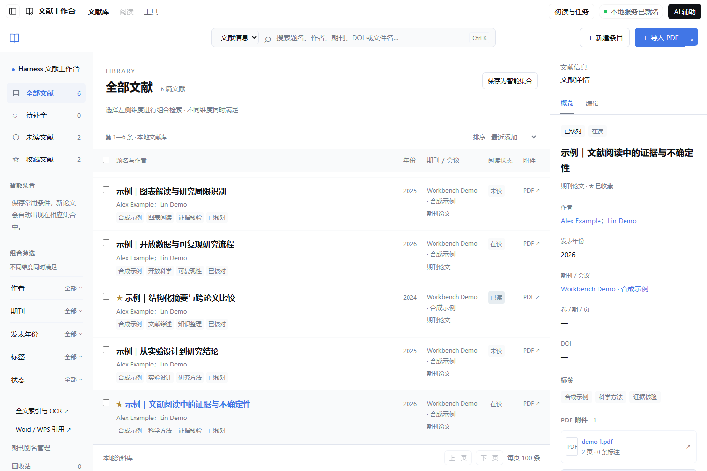
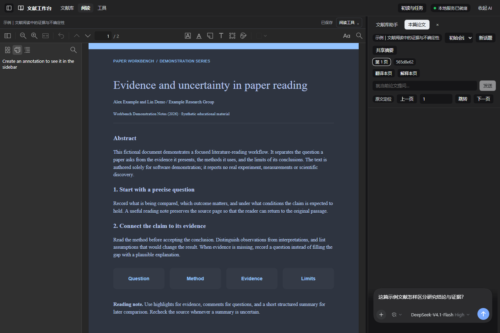

# 文献工作台 · DeepSeek Harness 插件

在 DeepSeek Harness（DSH）中整理、阅读和批注文献，按需打开 AI 侧栏。当前插件版本 **0.2.7**，已验证平台为 **Windows x64 + DSH 0.2.2-rc.1**。

**[下载 Windows x64 插件安装包](https://github.com/Cluodwaters/dsh-paper-workbench/releases/latest/download/dsh-paper-workbench-windows-x64.tgz)**

需要后续在线更新，请按下文的在线地址安装；也可下载后保持 `.tgz` 原样，在 DSH「插件 → 安装本地插件」中选择它。`sources.tar.gz` 和 GitHub 的 `Source code` 是开发源码，不能直接安装。若提示「这个包没有声明组合包」，请核对选择的是上面的 `.tgz` 文件。

- 独立「文献工作台」入口，沿用 DSH 主题，提供文献库、PDF 阅读器和工具页。
- 文献详情支持移入回收站和恢复，也可以勾选多篇批量操作。移入回收站后保留 PDF、批注和会话绑定。
- 在「DSH 设置 → 文献工作台」自定义资料保存位置；保存后完整重启，自动复制并校验已有资料，保留旧目录。完整聊天记录仍由 DSH 管理。
- 拖动 AI 侧栏左边的分隔线调整宽度，自动记住上次的设置；双击恢复默认，方向键可微调。
- 文献库助手按需检索标题、作者、期刊、年份、标签和已保存摘要；不直接读取论文全文或完整论文对话。
- 每篇论文有独立 DSH 对话。导入后默认自动初读，识别基础信息，保存主题、科学问题、方法、行文逻辑、发现、局限和待核查问题。
- 主助手可以委派单篇论文任务。委派会话与用户阅读会话分开，共享带版本与来源的论文摘要。
- 复用 DSH 原生会话持久化和上下文压缩，使用 SQLite FTS5 按需检索，避免把整个资料库塞入上下文。
- 普通整理、阅读、批注和本地 OCR 不需要模型。自动初读、翻译与问答使用 DSH 当前账号和模型；可设置 `autoRead: false` 关闭后续导入的自动初读。

## 在其他设备安装

1. 在 Windows x64 设备安装兼容的 DSH，并配置好需要使用的模型账号。
2. 在 PowerShell 中通过固定在线入口安装（仓库和下载已公开，无需 GitHub 登录）：

   ```powershell
   dsh plugin --profile desktop add "https://github.com/Cluodwaters/dsh-paper-workbench/releases/latest/download/dsh-paper-workbench-windows-x64.tgz"
   ```

   如果 `dsh` 未加入 PATH，使用 DSH 安装目录内的 `resources/runtime/cli/bin/dsh.cmd`：

   ```powershell
   & "<DSH安装目录>\resources\runtime\cli\bin\dsh.cmd" plugin --profile desktop add "https://github.com/Cluodwaters/dsh-paper-workbench/releases/latest/download/dsh-paper-workbench-windows-x64.tgz"
   ```

3. 从 DSH「应用 → 退出」完整退出再重新打开，在左侧进入「文献工作台」。仅关闭窗口可能隐藏到托盘，未必重新加载插件。

也可下载上方 `.tgz`，在 DSH 插件页面选择「安装本地插件」。这种安装来源是本机文件；要启用在线更新，需再运行一次上面的在线安装命令。

### 从旧版本更新与插件商店

**0.2.6 修复了本插件后台占用安装包的问题。** 后台从 DSH 用户目录中的独立运行副本启动；从本版升级后续版本时，可保持 DSH 打开，在商店应用更新，安装成功后按宿主提示重载或重启。论文、摘要和会话继续使用原存储。

**0.2.5 及更早版本首次迁移：** 在 DSH 插件管理中停用文献工作台，待停用完成后在 DSH 内安装新版，再启用。0.2.5 迁移至 0.2.6 时已通过 DSH 原生管理接口验证这套流程。若宿主提示停用需重启，按提示重启后再安装。通过本地 `.tgz` 安装的用户可以使用固定在线地址重新安装一次，接入在线更新通道。

文献工作台已收录到 dsh-market 的「文档与渲染」分类。通过固定在线来源安装的用户可以在 **dshmarket 插件商店 → 已安装 / 更新** 中检查并应用新版，随后按 DSH 提示重载或重启。收录和更新机制见 [市场收录说明](docs/marketplace/README.md)。

如果商店未出现更新，先刷新目录和更新列表，并确认安装来源不是 `file:` 或旧的带版本文件名地址。旧版 dshmarket 可能尚不支持 GitHub Release 更新，应先更新商店。国内网络无法检测版本时，可在 dshmarket「设置 → 插件 → 插件配置」选择中国大陆下载区域后重试。网络或 GitHub 下载失败时保留原安装，恢复网络后重试。

安装包包含后台 Node 25.8.1、生产依赖、阅读器、OCR 模型和许可证，日常使用无需自行构建。当前安装包不能直接用于 macOS、Linux 或 Windows ARM。

| 下载文件 | 用途 |
|---|---|
| **`dsh-paper-workbench-windows-x64.tgz`** | **完整安装包；固定文件名用于商店的在线更新通道** |
| `dsh-paper-workbench-0.2.7.tgz` | 同一安装包的带版本文件名副本，用于手动安装与归档 |
| `dsh-paper-workbench-0.2.7-sources.tar.gz` | 开发者源码，包含固定版本上游源码；按 `BUILD.md` 构建后才能安装 |
| GitHub 自动生成的 `Source code (zip / tar.gz)` | 仓库源码快照；不能作为插件安装 |
| `SHA256SUMS.txt` | 下载文件的校验值 |

下载页同时提供 `SHA256SUMS.txt`。可运行 `Get-FileHash -Algorithm SHA256 "<安装包绝对路径>"`，与清单中的值比较。

### 提示「这个包没有声明组合包」

先看失败详情中的文件名。如果是 `*-sources.tar.gz` 或 `Source code`，重新下载并安装上面的 `.tgz`。源码仓库根目录是独立应用，插件声明 `dsh.bundle` 位于 `plugins/dsh-paper-workbench/package.json`；预构建安装包已经把它放到正确的包根目录，并带齐运行资源。给源码包改扩展名或只解压子目录都不能替代构建。

这个错误发生在插件注册阶段。重新选对安装文件即可继续，无需重装 DSH 或删除论文资料库。如果正确 `.tgz` 仍报错，请在 [Issues](https://github.com/Cluodwaters/dsh-paper-workbench/issues) 附上 DSH 版本、Windows 架构和安装错误信息，勿附模型密钥或个人文献。

## 界面预览

以下为独立演示资料库的实际界面，文献、作者和摘要均为明确标注的合成示例。浏览器版使用普通顶栏；Windows 桌面版将导航合并到系统顶栏。





## 数据与会话

默认资料库位于 `%LOCALAPPDATA%\dsh-paper-workbench\data`，与插件安装目录分开。插件保存论文、批注、元数据、摘要、任务和会话绑定；完整对话保存在 DSH 的原生会话存储中。

**安装插件不会迁移或同步原设备的论文和聊天。** 完整迁移需要分别处理插件资料库及其关联的 DSH 会话；仅复制资料库不能恢复完整聊天。备份前应完整退出 DSH，再复制整个资料库目录。卸载插件不删除资料库。

本仓库不包含个人论文、资料库、聊天记录、模型凭据或浏览器资料。公开截图仅使用合成演示资料；本机验收日志和个人资料始终不发布。

## 开发与架构

这是包含插件与本地后台的完整源码仓库。源码中的独立应用版本为 0.3.2，DSH 插件版本为 0.2.7，两者版本号分别维护。

| 路径 | 内容 |
|---|---|
| `plugins/dsh-paper-workbench/` | DSH Host、前端入口、Agent 调度、打包和独立运行验证 |
| `src/domain/`、`src/application/`、`src/storage/` | 领域规则、用例与事务存储 |
| `src/web/`、`src/adapters/`、`src/server/` | 阅读界面、外部组件适配与本机传输接口 |
| `desktop/` | 原独立应用入口与 Word 连接器源码 |
| `scripts/`、`tests/` | 固定上游源码恢复、构建和验证 |
| `resources/` | OCR 模型、引用样式、图标和许可证 |

- [插件使用、Agent 关系及上下文限制](plugins/dsh-paper-workbench/README.md)
- [构建、测试与发布说明](BUILD.md)
- [版本记录](CHANGELOG.md)
- [插件市场收录材料](docs/marketplace/README.md)
- [原独立应用说明](STANDALONE.md)
- [架构](ARCHITECTURE.md) · [第三方归属](THIRD_PARTY_NOTICES.md)

正文/OCR 初读不能代替图表与公式的视觉核验，AI 识别和摘要需对照原文。跨设备自动同步、向量检索和图像模型输入尚未实现。

## 许可证

项目及插件使用 [AGPL-3.0-only](LICENSE)。上游提交、资源摘要和依赖版本分别固定在 `sources.lock.json`、`sources.download.json`、`phase3-assets.lock.json` 与各 `package-lock.json` 中。发布包保留上游许可证与归属说明。
