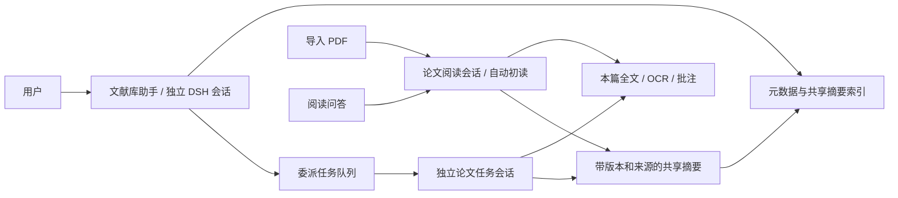

# 文献工作台 · DeepSeek Harness 插件 0.2.2

DSH 左侧的独立「文献工作台」入口提供文献库、PDF 阅读器和工具页；侧栏可切换「文献库助手」与「本篇论文」。采用 DSH 主题变量、中性与蓝色外观，搜索框相对文献库内容区水平居中。

拖动 AI 侧栏左边的分隔线可调整宽度，并在重新打开后恢复。分隔线支持左右方向键（按住 Shift 加快）、Home/End 和双击恢复默认。窄窗口改为上下布局，重新加宽后恢复偏好的侧栏宽度。

**新导入论文默认自动初读。** 导入事务同时为论文建立独立的 DSH 会话绑定与任务，后台准备全文索引后，第一条指令要求通读全文、识别书目信息并生成初步摘要。日常整理、阅读和批注本身不需要模型；自动初读、翻译和问答使用 DSH 当前默认账号与模型。已有论文不会在升级时自动批量重读。

## 使用

1. 点击「导入 PDF」。原件保持只读，受管理的副本进入独立资料库。
2. 「初读与任务」显示排队、逐页进度、失败原因，提供取消与重试。薄文本/扫描页先走现有 OCR 管线。无法识别页保留为阅读缺口。
3. 论文 Agent 从第 1 页开始分段读取。先识别题目、作者、期刊、年份；不确定字段留空。仅填充未人工编辑的字段，导入的初始题名可被纠正；版本冲突时保留识别候选，保护人工修改。
4. 全文检查点齐备后保存主题、科学问题、方法、行文逻辑、发现、局限和待核查问题。摘要标注来源页、来源哈希、版本、文本覆盖与 AI 未核验状态。
5. 打开论文时恢复该论文的 DSH 对话，自动初读过程可见。普通问答后助手合并共享摘要；未保存时显示「摘要待更新」，不会提前宣告保存成功。
6. 「新话题」建立空上下文的独立会话；话题菜单可回到旧会话。历史由 DSH 保留，共享摘要仍属于该篇论文。新话题可先读取既有摘要，无需复制完整聊天。

## 主助手与论文助手



- **主助手**只通过目录与摘要工具访问标题、作者、期刊、年份、标签、阅读状态等元数据及已保存摘要。原文、原文摘要字段、PDF 路径和完整论文对话不进入主助手工具返回值。按用户要求可修改标签、收藏与阅读状态，仍检查最新资料库版本。
- **论文阅读助手**绑定稳定的 `attachmentId + sourceHash`，只能读本篇。选区和页码由 Host 注入；主会话不接收这些上下文。
- **委派助手**是绑定同一论文的另一个 DSH 会话，有任务 ID、租约和所有者。它先读旧摘要，再按需读相关页并保存合并结果；主助手只取回状态与摘要。委派消息不进入用户阅读对话。
- **后台调度器**复用 DSH 的 Agent、模型选择、持久化与原生工具执行。最多并发 2 个任务，自动初读最多占 1 个名额；委派优先，同篇任务串行。空闲 Agent 会释放，持久化会话保留。

## 上下文与持久化

复用 DSH 原生 compaction 和 SQLite FTS5，不引入额外 Agent 框架、外部记忆服务或向量数据库。

论文会话使用插件自带的 `paper-workbench` 原生预设装配压缩服务，通过 `agentPresets.serviceFor` 访问隔离组中的服务。升级时恢复旧会话并记录预设选择，保留会话 ID、历史和阅读检查点。每次初读只提交一条任务指令；保存每页笔记后在同一轮继续，发布摘要后允许模型完成可见回答。只有正常提前结束且已推进阅读位置时，才在 `whenIdle()` 和持久化完成后尝试续读；错误和用户停止不会自动追加指令。

| 范围 | 默认上限与处理 |
|---|---|
| 主助手目录检索 | 每页 20 条元数据、最多 8 个摘要匹配；不装载整个文献库 |
| 单轮主助手 | 最多展开 8 篇摘要、派发 8 个任务；任务查询一次最多等 40 秒 |
| 论文读取 | 每段 12000 字符；按页读取一次最多 4 页，总计 12000 字符 |
| 初读工作记忆 | 7000 字符，另存每段简短检查点；长单页按偏移续读 |
| 共享摘要 | 7 个文本字段各最多 700 字符，总计最多 4200 字符；来源页最多 30 个 |
| 批注 | 每次 10 条，单条正文和评论各最多 600 字符 |
| 会话上下文 | 主助手约 24k、论文助手约 48k token 触发 DSH 压缩；仍超限则保留历史并提示新话题 |
| 单次任务 | 最长 30 分钟；异常提前结束最多补发 2 次续读，无阅读进展立即暂停，可从检查点重试 |

完整对话由 DSH 原生会话日志保存。插件资料库保存绑定、当前话题、任务、来源阅读记录、检查点和不可变摘要版本；`localStorage` 仅用于界面恢复及旧版绑定迁移，不再是会话身份的唯一来源。

论文工具先等待 DSH `sessions.flush`，再以 `sourceSeq` 保存摘要。摘要采用版本检查；并发更新冲突时重新获取后合并。索引只检索最新有效摘要，归档论文不参与检索。全文/OCR 始终是派生数据，不向 PDF 写入 OCR 文本。

初读、重试和重复导入保持幂等。取消使租约失效，迟到结果不能覆盖状态。正常关闭将任务回到队列；异常退出后租约到期恢复。重试保留会话与读取位置。数据库升级先生成备份。

## 安装与构建

宿主：DSH `0.2.2-rc.1`。插件自带 Node `25.8.1`、后台生产依赖、Reader、OCR 模型及许可证，后台独立于源码目录运行。

```powershell
node plugins/dsh-paper-workbench/tools/package.mjs
cd plugins/dsh-paper-workbench/dist
npm pack --pack-destination .. --ignore-scripts
dsh plugin --profile desktop add <dsh-paper-workbench-0.2.1.tgz 的绝对路径>
```

`dsh` 未加入 PATH 时使用 DSH 安装目录的 `resources/runtime/cli/bin/dsh.cmd`。通过官方插件管理安装后，从 DSH「应用 → 退出」完整退出再打开以加载新版本；关闭窗口可能仅隐藏到托盘。卸载插件不删除资料库。

## 可选配置

配置位于插件行的 `config`，默认即可使用。

| 键 | 默认 | 说明 |
|---|---|---|
| `backendRoot` | 包内 `resources/backend` | 开发时可指向后端源码目录 |
| `nodeExecutable` | 包内 `resources/runtime/node.exe` | 后台 Node ≥ 25.8.1 |
| `dataRoot` | `%LOCALAPPDATA%/dsh-paper-workbench/data` | 独立资料库，不可与运行中的独立应用共用 |
| `autoIndex` | `true` | 为缺失全文建立索引 |
| `autoRead` | `true` | 新导入时创建初读任务；关闭仅影响后续导入，已有任务可在界面取消 |
| `startupTimeoutMs` | `120000` | 本地后台就绪超时 |

`harness-conversations/` 是专用会话工作目录，`logs/backend.log` 为后台日志。私有 bridge token 只存在于 Host 内存与后台环境，浏览器不能直接访问内部 Agent 管理 API。权限由持久化绑定、工具白名单和单论文服务校验共同约束。

## 验证与限制

- `npm test` 覆盖存储、来源处理、任务恢复、版本冲突、会话隔离及 Host 接入；`scripts/validate-harness.mjs` 检查阅读器、桥接、主题、保存失败与导出路由。
- `tests/agent-coordinator.test.mjs` 覆盖自动首条指令、原生停止、关闭续读、主助手工具范围与压缩调用。
- 独立 DSH 真实模型验收使用合成论文，验证自动识别与初读摘要、问答后更新、主助手委派、话题切换和重启恢复；记录位于根项目 `output/harness-validation/`。
- `tools/verify-package.mjs --fixture <合成论文路径>` 从源码目录外启动打包副本，核对 Node、依赖与浏览器行为。普通阅读回归关闭自动初读，自动初读另由真实模型验收覆盖。
- 文本/OCR 初读无法可靠解释图表、复杂公式和版面语义；界面标注待核查，文本覆盖不等于视觉内容完整理解。
- AI 提取和摘要需人工核验；扫描质量、模型服务和限额会影响完成时间。任务失败有明确状态，可重试。
- 目前采用本地关键词与摘要检索。向量检索、图像模型输入和专题知识库尚未实现。话题菜单显示最近 50 个会话，完整历史仍由 DSH 保存。

## 许可

项目与插件使用 AGPL-3.0-only。Zotero Reader 固定提交与构建资源、Tesseract.js、OCR 模型、citeproc 和 CSL 样式的版本与许可随包保留，见 `sources.lock.json`、`THIRD_PARTY_NOTICES.md` 和 `resources/backend/resources/licenses/`。
